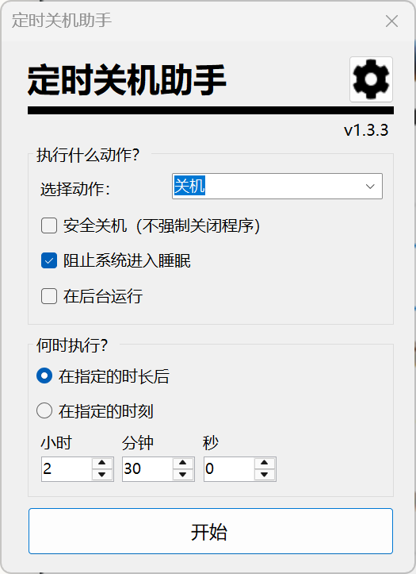
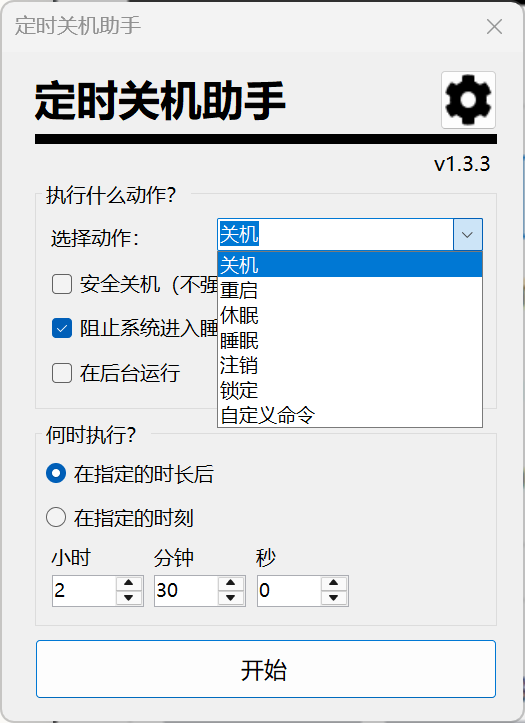
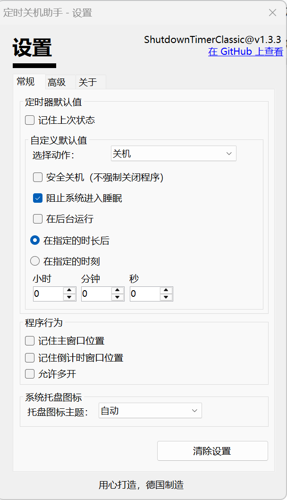
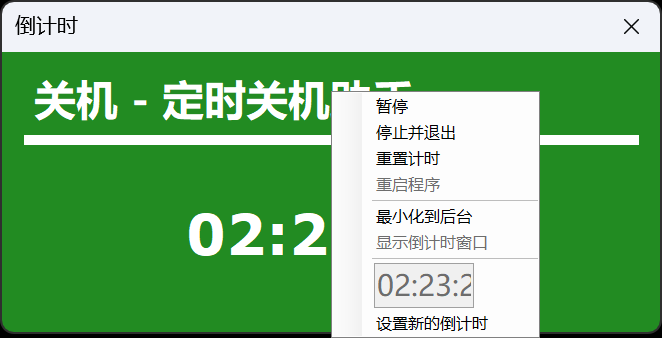
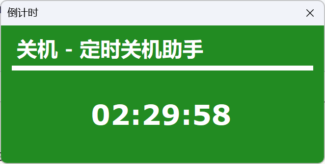
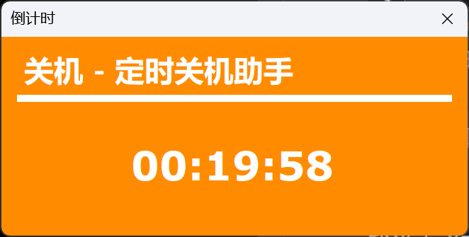
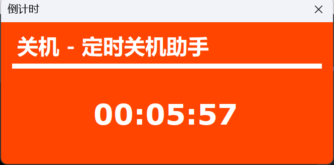

# Shutdown Timer Classic 🕒 中文版

本文件是上游英文版 [README](README.upstream.md) 的中文翻译。原作者：[Lukas Langrock](https://github.com/lukaslangrock/ShutdownTimerClassic)，MIT 许可。本仓库在其基础上增加了简体中文界面与高 DPI（Per-Monitor V2）修复。

---

# Shutdown Timer Classic 🕒

Shutdown Timer Classic 是一个小巧的 Windows 应用程序，可以设置一个定时器，到点后自动关机、重启、休眠、睡眠或锁定电脑。



我之后还打算开发一个更高级、更漂亮的版本。

**想贡献代码或者看看我的代码？** 太好了，我欢迎*人类*的贡献，也很想听听你的意见。想上手的话，可以先看看我的[文件与目录结构](Structure.md)文档，了解各个部分是怎么关联起来的。

# 安装 💿

**推荐**：[Microsoft Store](https://www.microsoft.com/store/apps/9NTDG6C9BTTW?cid=github.com)

Microsoft Store 是唯一一个会自动更新的官方下载渠道（更新由微软管理，而程序本身不联网、无法自行检查更新）。

**备选**：[GitHub Releases](https://github.com/lukaslangrock/ShutdownTimerClassic/releases) 或[作者的镜像](https://files.langrock.info/apps/ShutdownTimerClassic/)。

这些构建随每个稳定版一同提供，包含可直接运行的二进制文件和一个安装程序。如果你想直接用二进制文件，请解压整个压缩包，并保持所有文件在同一个文件夹内。

**开发版**：这是我的一个低优先级副业，所以发版很稀疏。不过本项目配置了 CI，会为每次新提交生成并发布构建产物。这些是开发版，可能无法正常工作，也可能包含尚未完成的功能，请自行斟酌使用（这也是这里不放链接的原因——它们不适合不熟悉软件开发的人）。

# 使用 ✨

Shutdown Timer 用法很简单。
从下拉菜单里选一个电源动作，再拨好你想要的时间。倒数归零时，所选的动作就会执行。

归零时，Shutdown Timer（实际上是 Windows 干的，Shutdown Timer 只是发出指令）会强制关闭所有仍在运行的程序，以确保关机不被打断。
所以如果关机开始时某个程序正在保存或处理数据，你可能会丢失数据。
你可以通过把时间设得更长、给运行中的程序留出足够的时间来完成操作来规避，或者选择 *睡眠* 或 *休眠* 这两个动作。

如果你确定所有程序都能正常退出、不需要人工干预（比如文字处理器在收到退出指令后弹出保存对话框），可以选择「安全关机」，它就像你手动关机一样执行一次普通的关机。
这意味着所有程序都有充足时间退出，不会有任何程序被强制结束（但反过来说，程序也可能因此打断关机）。
所以用这个模式要小心，因为它可能导致关机失败。
*安全模式适用于所有会强制关闭程序的电源动作，并非关机专用。*

默认情况下，倒计时窗口会始终显示在其他所有窗口之上，这样你就不会忘记自己开着定时关机。勾选下拉菜单下方的「在后台运行」可以隐藏倒计时窗口。如果倒计时已经在运行，你也可以在倒计时窗口任意位置右键，呼出菜单并选择最小化到后台。也可以通过托盘菜单（见下文）把它重新调出来。






# 颜色 🎨

倒计时窗口有 4 种不同的背景颜色来表示剩余时间，还有一个动画用来在你快忘记定时关机时提醒你。
下面是速览：

| 剩余时间    | 颜色         | 有动画 |
| ----------- | ------------ | ------ |
| > 30 分钟   | 绿色         | 否     |
| 30 - 10 分钟 | 黄色        | 否     |
| 10 - 1 分钟  | 橙色        | 否     |
| < 1 分钟     | 红色 / 黑色   | 是     |






# 托盘菜单 🔧

Shutdown Timer 还带一个托盘菜单，可以从任务栏托盘控制程序。在图标上右键即可呼出（你可能需要点击任务栏右侧的小箭头才能找到它）。你可以从中停止、重启、查看计时器，也可以切换 UI 模式来隐藏或显示倒计时窗口。


在倒计时窗口里右键也能打开同一个菜单。

# 命令行 💻

你也可以用命令行启动 Shutdown Timer，并指定参数和设置。
**注意**：程序对命令行参数的校验方式和对界面输入的校验不一样。拼写错误或缺少参数都可能引发意料之外的行为。请在脚本中使用前先测试你的命令！

要用附加参数启动程序，请用文件资源管理器导航到程序所在文件夹。如果你用的是 Microsoft Store 版本，我建议改为从 GitHub releases 页面下载另一个版本，因为商店提供的二进制文件本来就不是给用户手动启动的。
如果你用的是安装程序安装的，文件夹应该在 `C:\Program Files (x86)\Lukas Langrock\Shutdown Timer Classic`。
如果你选了不带安装程序的 ZIP，请把 ZIP 里的**所有**文件复制到你选择的任意文件夹，不要重命名任何文件。

然后在资源管理器里右键，选择「在终端中打开」，输入 `.\ShutdownTimerClassic.exe`，按精确的参数名、每个参数之间用空格分隔来添加参数：

```
参数                     说明

/SetTime <time>          设置倒计时时间。可以直接填秒数，也可以用 HH:mm:ss 或 HH:mm。

/SetAction <action>      设置倒计时归零后要执行的电源动作。
                         必须输入界面上显示的精确名称（例如 Shutdown、Restart 或 Sleep。
                         不要用 shutdown、Reboot、SLEEP 等其它变体）。

/SetMode <mode>          设置控制模式。任何命令行参数要生效都必须设置它。可用模式：
                         Prefill:       预填设置，但用户仍可手动修改。不会自动开始计时。
                         Lock:          覆盖设置且用户无法修改。不会自动开始计时。
                         Launch:        覆盖设置并开始计时。
                         ForcedLaunch:  覆盖设置并开始计时，禁用所有界面控件和退出对话框。

/SetPassword <password>  设置一个用于锁定界面的密码。密码存放在程序内存里，但因为是以参数
                         形式传入的，很容易被泄露。另外如果程序崩溃，它也会出现在日志里！
                         绝对不要复用任何需要保密的密码！

/SetCommand <command>    当你选择「自定义命令」动作时，要执行的命令（或文件）。以当前用户权限运行。

/Graceful                在可用时使用安全模式。也就是执行一次普通的、可被打断的关机。
                         当程序抵抗关闭事件时，关机可能失败。只在你清楚后果时使用。

/AllowSleep              允许电脑在倒计时期间进入睡眠。

/Background              在后台运行倒计时。
                         这不是静默模式，用户仍会收到通知，也能使用托盘菜单。

/NoSettings              使用临时的临时设置，忽略 settings.json 文件。

/TargetTimeOfDay         倒计时到某个指定时刻（几点），而不是从此刻开始倒数。
```

示例：`.\ShutdownTimerClassic.exe /SetTime 01:00 /SetAction Hibernate /SetMode Launch`
这条命令会以休眠模式、1 小时 0 分 0 秒启动 Shutdown Timer 并开始倒计时。

如果你想在自己的应用或脚本里重新分发我的可执行文件，完全可以。请记得保持更新，并在描述中提及这个项目（也就是遵守本项目的许可证）。

# 行为说明 📄

## 关机流程

执行关机时，所有窗口都会被关闭，无论它们是否抵抗——任何未保存的工作都会丢失！这是为了确保你的电脑确实关掉，不会被其它进程阻止。

如果你想要一次普通的关机，可以启用安全模式。它不会强制关闭任何程序，但也可能导致关机失败，因为任何收到退出请求后不退出的程序都可能让关机暂停。程序不退出可能是因为无响应、需要用户交互，或者仍在工作中。

请注意，你那份特别重要的文档没有保存、现在没了，这种数据丢失我不承担责任。那是你的错！

## 取消关机

只要计时器还没归零，你随时可以按关闭按钮（右上角那个大 X）取消倒计时。随后会弹出一个对话框询问是否要取消。如果选择取消，倒计时会立即停止，并提示取消成功、点击确定后程序将关闭。此时倒计时其实已经停了，你有充足的时间再点确定，点完程序才会自行退出。

如果你让它在后台运行，可以去通知区域（点击任务栏右侧的箭头）右键点击程序图标，菜单里会有「停止并退出」。点击它会取消关机，并弹窗告知取消结果。

## 日志与隐私

本程序**不联网**，也**不收集使用数据**。如果发生内部异常，它会把堆栈跟踪和简单的事件日志保存到用户桌面（自 v1.2.0 起）并通知用户，但不会自动与任何人分享数据。如果你用的是 Microsoft Store 版本，商店还会监测基本使用情况和崩溃信息，并（取决于你的 Windows 隐私设置）与微软和作者共享这些数据。
